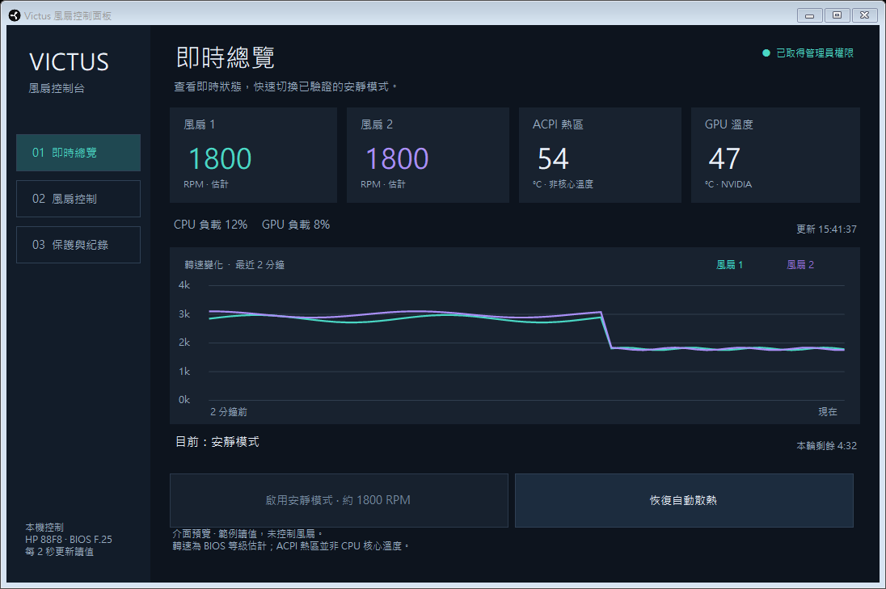

# Victus Fan Control Panel

針對特定 HP Victus 筆電製作的 Windows 桌面風扇控制面板，提供約 1800 RPM 的短時間安靜模式與原廠自動散熱交接。

**實驗性、機型限定工具。** 目前只允許主機板 **88F8／BIOS F.25** 啟用控制。已短暫實測的配置為 HP Victus 16-d0xxx、Intel Core i5-11400H、NVIDIA RTX 3060 Laptop GPU；不代表其他同系列配置均已驗證。這不是 HP 官方軟體。

[下載最新版本](https://github.com/baka9881/victus-fan-control-panel/releases/latest) · [回報問題](https://github.com/baka9881/victus-fan-control-panel/issues) · [MIT 授權](LICENSE)



*畫面使用範例讀值，未執行硬體控制。*

## 功能

- 即時顯示兩個風扇的估計轉速、ACPI 熱區、GPU 溫度與 CPU／GPU 負載。
- 顯示最近兩分鐘的轉速曲線。
- 一鍵啟用約 1800 RPM 的安靜模式，每次最多五分鐘。
- 隨時恢復自動散熱，正常關閉時也會先恢復。
- 溫度、負載升高或讀值失效時提前恢復散熱；附獨立備援程序。
- 本次操作紀錄與圓形黑白圖示。

不提供強制停轉、1 RPM、任意轉速或開機自動套用設定。

## 使用方式

1. 從 [Releases](https://github.com/baka9881/victus-fan-control-panel/releases/latest) 下載 `VictusControlPanel.exe`，或下載可攜 ZIP。
2. 開啟程式，按「取得管理員權限」，完成 Windows 權限提示。
3. 在低負載、低溫時按「啟用安靜模式」。需要交回原廠管理時按「恢復自動散熱」。

開啟程式本身不會套用轉速。無效讀值或不符機型時，控制會停用。單一執行檔可直接使用，不會安裝驅動、服務或開機啟動項目，也不修改 BIOS 的 Fan Always On。

需要 Windows 11 x64、現有 NVIDIA 驅動中的 NVML，以及 .NET Framework 4.8 或更新的 4.x 版本。介面目前為繁體中文。程式未經數位簽章。

## 已知限制與恢復條件

轉速來自 BIOS 等級估計，**不是獨立轉速計測量**。ACPI 熱區也**不等於 CPU 核心溫度**。目前完成短暫降速與恢復測試，尚未完成長時間散熱驗證。

啟用低速前，須讀到有效資料，且 ACPI 熱區低於 60°C、GPU 低於 55°C、CPU 總負載不超過 25%、GPU 負載不超過 30%。

低速期間遇到下列條件時，會嘗試恢復原廠自動散熱：

- ACPI 熱區達 60°C 或 GPU 達 55°C。
- CPU 負載達 70%、持續四秒達 35%，或 GPU 負載達 50%。
- 監測失效、風扇未維持目標範圍，或本輪五分鐘結束。
- 正常關閉程式。

獨立備援程序會監看主程式與心跳，異常時先寫入正轉等級，再送出 Balanced／BIOS 自動控制交接指令；交接失敗時會嘗試更高風量。這些是保守的應用程式設定，不是 HP 公布的安全上限，也不能保證每種故障下都能恢復。遇到恢復錯誤時，請依面板訊息重試，並使用原廠工具確認散熱狀態。

## 建置

不需要安裝 .NET SDK 或 NuGet 套件。於 Windows PowerShell 或 PowerShell 執行：

```powershell
.\build.ps1
```

輸出位於 `artifacts/VictusControlPanel.exe`。編譯使用 Windows .NET Framework 的 C# 編譯器，將警告視為錯誤。

若要重新產生圖示：

```powershell
.\tools\New-AppIcon.ps1
```

## 測試

```powershell
.\test.ps1
```

測試包含九項控制行為與七種尺寸的 Windows 原生圖示透明度檢查，**不調整硬體轉速**。測試產物寫入 `artifacts/tests/`，不執行刪除或清理命令。

控制測試涵蓋無效讀值拒絕啟動、監測中斷、溫度／負載升高、五分鐘上限、恢復失敗及重試、獨立恢復結果，以及風扇未維持目標範圍。獨立備援的程序握手曾於本機驗證；沒有故意讓實機當機來測試恢復。

## 原始碼

| 位置 | 用途 |
| --- | --- |
| `src/QuietCore.cs` | 安靜模式、保護條件、時間限制與恢復狀態 |
| `src/QuietHardware.cs` | 限定機型的 HP WMI 控制、ACPI 與 NVIDIA 讀取 |
| `src/QuietRecovery.cs` | 獨立程序與共享記憶體備援 |
| `src/QuietDashboard.cs` | Windows Forms 控制面板 |
| `src/QuietApp.cs` | 程式入口與單一控制實例 |
| `tests/` | 不操作硬體的測試 |
| `tools/New-AppIcon.ps1` | 圓形圖示與透明遮罩產生器 |

回報問題時，請提供機型、主機板型號、BIOS 版本與錯誤訊息，並移除序號、帳號、私人路徑等資訊。

## 授權與參考

本專案以 [MIT](LICENSE) 授權發布。公開的 HP WMI 協定研究與同型號回報提供了重要參考，詳見 [ACKNOWLEDGEMENTS.md](ACKNOWLEDGEMENTS.md)。本專案沒有附帶第三方驅動或上游工具的執行檔。
